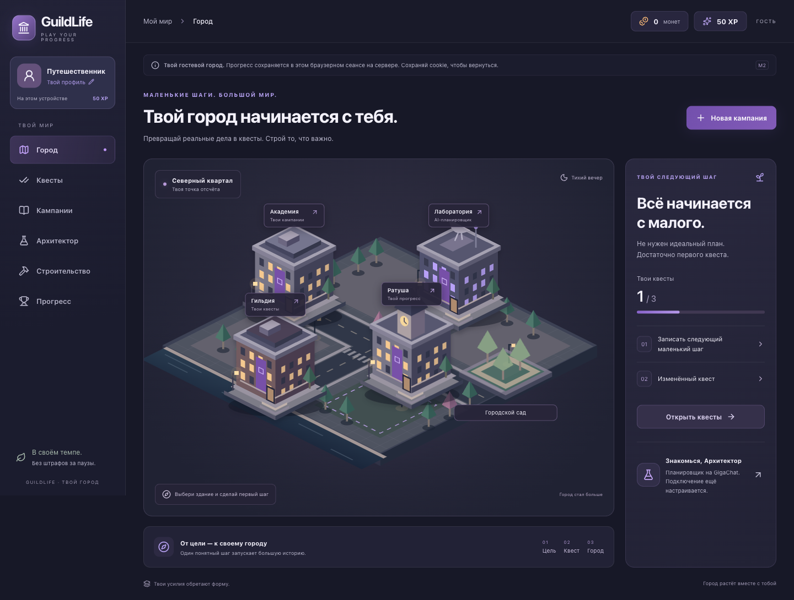

# GuildLife 🏙️

**Turn real-life goals into quests. Build your city. Work alongside an AI planning companion.**

> **Project status: persistent local vertical slice (M2), with a GigaChat adapter ready for configuration.**
> Campaigns, quests, rewards and construction use FastAPI + PostgreSQL. A visible local profile supports your own name/photo. Live GigaChat calls and public hosting are not configured yet.



Actual local UI. [Mobile](output/playwright/m2-mobile.png) · [Current evidence](docs/22_M2_EVIDENCE.md) · [Run/deploy guide](docs/21_RUN_AND_DEPLOY.md). Original concepts remain in `assets/concepts/`.

## Why GuildLife?

Typical task managers show a list of to-dos. GuildLife visualizes progress as a growing isometric city: finish meaningful tasks, earn in-game resources, unlock buildings, and turn a large goal into a manageable quest campaign with an AI planner.

**The real goal of this project:** demonstrate end-to-end product thinking, delivery management and hands-on full-stack / AI understanding — with a delightful, functional vertical slice.

## Demo narrative

1. Set a real goal, deadline and weekly capacity.
2. Create a campaign manually; with configured GigaChat, request a draft and **review/edit it before saving**.
3. Complete a quest; XP and coins are awarded once by the server.
4. Spend the reward on a building, watching the city change.
5. Inspect campaign progress and real AI job status (weekly recap is a stretch feature).

## Feature status

| Feature | MVP commitment | Implementation |
|---|---|---|
| Isometric city + building unlock | Yes | Four clickable SVG buildings + one plot; garden/workshop purchases persisted |
| Campaigns, quests, completion, rewards | Yes | Persisted CRUD, server-confirmed completion, transactional rewards and ledger |
| One AI planner with user approval | Yes | GigaChat adapter, validation, review and accept implemented; real-provider evaluation pending |
| Persistent state in PostgreSQL | Yes | Implemented with Alembic migrations |
| Guest demo experience | Yes | Isolated HttpOnly guest cookies, 7-day TTL; per-guest seed |
| Focus timer / Kanban / complex NPC workflows | Stretch | Not started |
| Multi-agent integrations, payments, PvP | No | Out of scope |

## Proposed technical stack

- **Frontend:** React + TypeScript + Vite; stateful map UI, game panels, interaction.
- **Backend:** Python + FastAPI + Pydantic; domain logic and REST endpoints.
- **Database:** PostgreSQL + SQLAlchemy + Alembic; transactional XP/coins/buildings.
- **AI:** Server-side GigaChat integration; structured output, validation, explicit approval, guest/global call limits. No live credentials configured.
- **Engineering:** Docker Compose, pytest against PostgreSQL, Vitest + Testing Library, ESLint, Ruff, TypeScript and GitHub Actions configuration. Remote CI has not run yet.

> No Supabase, LangGraph, 3D engine or subscriptions in MVP. Decisions are documented in [ADRs](docs/08_DECISIONS_ADR.md).

## Documentation

| Document | Why it exists |
|---|---|
| [Start here](docs/00_START_HERE.md) | Status, navigation and next action |
| [Product brief](docs/01_PRODUCT_BRIEF.md) | Goal, audience, hypothesis, value proposition |
| [PRD](docs/02_PRD.md) | Requirements, scope, constraints, acceptance |
| [Personas / validation](docs/03_RESEARCH.md) | Assumptions and research plan |
| [User journeys](docs/04_USER_JOURNEYS.md) | End-to-end flows and edge cases |
| [Game design](docs/05_GAME_DESIGN.md) | XP, currency, buildings, fair progression |
| [AI design](docs/06_AI_DESIGN.md) | Agent behavior, safety, statuses, budget |
| [Architecture](docs/07_ARCHITECTURE.md) | Context, components, data and APIs |
| [Architecture decisions](docs/08_DECISIONS_ADR.md) | Tradeoffs and why we made them |
| [Delivery roadmap](docs/09_ROADMAP.md) | Milestones and exit gates |
| [Backlog](docs/10_BACKLOG.md) | Stories, priorities, dependency map |
| [Quality plan](docs/11_QUALITY_PLAN.md) | Test matrix and release gate |
| [Metrics](docs/12_METRICS.md) | Success measures and event taxonomy |
| [Risks](docs/13_RISKS.md) | Risk register and mitigations |
| [Launch & portfolio](docs/14_LAUNCH_PORTFOLIO.md) | Honest release and interview narrative |
| [Visual language](docs/15_VISUAL_SYSTEM.md) | Consistent design and asset rules |
| [Operating rules](docs/16_WORKFLOW.md) | PM/engineering workflow, Definition of Done |
| [First sprint](docs/17_SPRINT_01.md) | Ready-to-execute first work block |
| [Traceability matrix](docs/18_TRACEABILITY.md) | Connect PRD requirements to issues and tests |

Also: [CSV backlog](planning/backlog.csv), [risk register](planning/risk_register.csv), [acceptance checklist](planning/acceptance_tests.csv), [GitHub issue/PR templates](.github/).

## Design concepts

The [eight concept screens](assets/concepts/) are **explorations of the wider vision**, not a committed feature list. Larger mockups deliberately include features that will not ship in the MVP.

| Step | Mockup |
|---|---|
| Create campaign | [01](assets/concepts/01_create_campaign.png) |
| AI campaign plan | [02](assets/concepts/02_ai_campaign_plan.png) |
| Daily quests | [03](assets/concepts/03_daily_quests.png) |
| Focus mode (stretch) | [04](assets/concepts/04_focus_mode.png) |
| Build with rewards | [05](assets/concepts/05_rewards_build.png) |
| AI workflow (future vision) | [06](assets/concepts/06_agents_workflow.png) |
| Projects board (stretch) | [07](assets/concepts/07_projects_board.png) |
| Weekly recap | [08](assets/concepts/08_weekly_recap.png) |

## How to run?

For the full app, install Docker/Compose and run from this repository root:

```sh
docker compose up --build -d
```

Open **http://localhost:8080**. The database lives in a named volume; ordinary `docker compose down` preserves it. No AI credentials are needed for manual campaigns, quests and construction. Live GigaChat is off by default.

For the separate development environment (Python/PostgreSQL + Vite), GigaChat environment variables, custom CA setup and deployment prerequisites, see the [run/deploy guide](docs/21_RUN_AND_DEPLOY.md).

```sh
cd frontend
npm ci --ignore-scripts
npm test
npm run lint
npm run build
```

Backend: `cd backend` then `.venv/bin/python -m pytest -q` against a dedicated PostgreSQL database ending `_test`; full setup is in the guide. Test fixtures reset only that test database.

Try **medium quest → 20 coins / 50 XP → garden for 60 coins → reload**. The initial wallet has 40 coins. Repeated completion cannot pay twice. The local profile photo/name stays in this browser and is never sent to GigaChat.

The explicit `?preview=1` mode retains the old UI-only mock with no persistence. The default app requires the server and shows a retry screen if unavailable.

Verification: **21 frontend tests, 41 PostgreSQL backend tests**, lint/type/build checks and browser tests of the persisted flow. [Evidence and limitations](docs/22_M2_EVIDENCE.md). No public URL or remote CI result is claimed.

External user agents are a future event-ingestion integration, not agents hosted or launched by GuildLife; see the [proposed contract](docs/20_EXTERNAL_AGENTS.md).

## Transparency

This project uses generative AI for ideation, design exploration and coding support. All code, requirements and architectural decisions must be reviewed and tested; the author should describe what was actually built and validated. Research findings and metrics will be added only after they exist. Brand name and external art licensing must be checked before public/commercial release.

**Working language:** product and engineering docs in Russian; README in English for portfolio accessibility.
