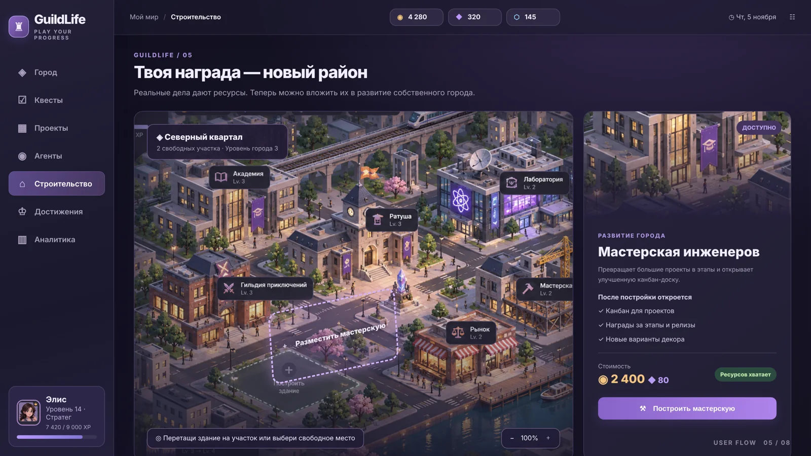

# GuildLife 🏙️

**Turn real-life goals into quests. Build your city. Work alongside an AI planning companion.**

> **Project status: Discovery & design — code and live demo are not available yet.**  
> This is a portfolio-oriented, AI-assisted indie productivity game concept, not a launched SaaS product. Screens below are **design mockups**, not screenshots of working software.

## Why GuildLife?

Typical task managers show a list of to-dos. GuildLife visualizes progress as a growing isometric city: finish meaningful tasks, earn in-game resources, unlock buildings, and turn a large goal into a manageable quest campaign with an AI planner.

**The real goal of this project:** demonstrate end-to-end product thinking, delivery management and hands-on full-stack / AI understanding — with a delightful, functional vertical slice.

## Demo narrative (planned)

1. Set a real goal, deadline and weekly capacity.
2. Ask the AI Planner for a suggested campaign and **review it before saving**.
3. Complete a quest; XP and coins are awarded once by the server.
4. Spend the reward on a building, watching the city change.
5. Inspect campaign progress and real AI job status (weekly recap is a stretch feature).

## Feature status

| Feature | MVP commitment | Implementation |
|---|---|---|
| Isometric city + building unlock | Yes | Not started |
| Campaigns, quests, completion, rewards | Yes | Not started |
| One AI planner with user approval | Yes | Not started |
| Persistent state in PostgreSQL | Yes | Not started |
| Guest demo experience | Yes | Not started |
| Focus timer / Kanban / complex NPC workflows | Stretch | Not started |
| Multi-agent integrations, payments, PvP | No | Out of scope |

## Proposed technical stack

- **Frontend:** React + TypeScript + Vite; stateful map UI, game panels, interaction.
- **Backend:** Python + FastAPI + Pydantic; domain logic and REST endpoints.
- **Database:** PostgreSQL + SQLAlchemy + Alembic; transactional XP/coins/buildings.
- **AI:** One server-side LLM integration; structured output, deterministic validation, cost controls.
- **Engineering:** Docker Compose (dev), pytest, frontend test runner, GitHub Actions (added with the first code milestone).

> No Supabase, LangGraph, 3D engine or subscriptions in MVP. Decisions are documented in [ADRs](docs/08_DECISIONS_ADR.md).

## Documentation

| Document | Why it exists |
|---|---|
| [Start here](docs/00_START_HERE.md) | Status, navigation and next action |
| [Product brief](docs/01_PRODUCT_BRIEF.md) | Goal, audience, hypothesis, value proposition |
| [PRD](docs/02_PRD.md) | Requirements, scope, constraints, acceptance |
| [Personas / validation](docs/03_RESEARCH.md) | Assumptions and research plan |
| [User journeys](docs/04_USER_JOURNEYS.md) | End-to-end flows and edge cases |
| [Game design](docs/05_GAME_DESIGN.md) | XP, currency, buildings, fair progression |
| [AI design](docs/06_AI_DESIGN.md) | Agent behavior, safety, statuses, budget |
| [Architecture](docs/07_ARCHITECTURE.md) | Context, components, data and APIs |
| [Architecture decisions](docs/08_DECISIONS_ADR.md) | Tradeoffs and why we made them |
| [Delivery roadmap](docs/09_ROADMAP.md) | Milestones and exit gates |
| [Backlog](docs/10_BACKLOG.md) | Stories, priorities, dependency map |
| [Quality plan](docs/11_QUALITY_PLAN.md) | Test matrix and release gate |
| [Metrics](docs/12_METRICS.md) | Success measures and event taxonomy |
| [Risks](docs/13_RISKS.md) | Risk register and mitigations |
| [Launch & portfolio](docs/14_LAUNCH_PORTFOLIO.md) | Honest release and interview narrative |
| [Visual language](docs/15_VISUAL_SYSTEM.md) | Consistent design and asset rules |
| [Operating rules](docs/16_WORKFLOW.md) | PM/engineering workflow, Definition of Done |
| [First sprint](docs/17_SPRINT_01.md) | Ready-to-execute first work block |
| [Traceability matrix](docs/18_TRACEABILITY.md) | Connect PRD requirements to issues and tests |

Also: [CSV backlog](planning/backlog.csv), [risk register](planning/risk_register.csv), [acceptance checklist](planning/acceptance_tests.csv), [GitHub issue/PR templates](.github/).

## Design concepts

The [eight concept screens](assets/concepts/) are **explorations of the wider vision**, not a committed feature list. Larger mockups deliberately include features that will not ship in the MVP.

| Step | Mockup |
|---|---|
| Create campaign | [01](assets/concepts/01_create_campaign.png) |
| AI campaign plan | [02](assets/concepts/02_ai_campaign_plan.png) |
| Daily quests | [03](assets/concepts/03_daily_quests.png) |
| Focus mode (stretch) | [04](assets/concepts/04_focus_mode.png) |
| Build with rewards | [05](assets/concepts/05_rewards_build.png) |
| AI workflow (future vision) | [06](assets/concepts/06_agents_workflow.png) |
| Projects board (stretch) | [07](assets/concepts/07_projects_board.png) |
| Weekly recap | [08](assets/concepts/08_weekly_recap.png) |

## How to run?

Application code has **not** been written yet. Run and deployment instructions will be added when the first vertical slice passes its acceptance tests. No fictional `npm install` or live URL is presented as working.

## Transparency

This project uses generative AI for ideation, design exploration and (later) coding support. All code, requirements and architectural decisions must be reviewed and tested; the author should describe what was actually built and validated. Research findings and metrics will be added only after they exist. Brand name and external art licensing must be checked before public/commercial release.

**Working language:** product and engineering docs in Russian; README in English for portfolio accessibility.
