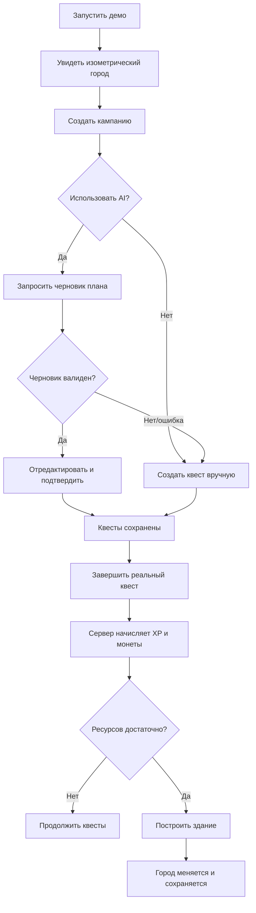

# 04. User journeys / UX flows

## Главный путь — `First Quest to First Building`

**Момент «вау»:** игрок нажимает «Построить», а на карте появляется новое здание. Это должно быть достижимо в первом демо без многочасового гринда (начальные монеты + награда первого квеста).

## Journey A — планирование цели

| Шаг | Экран | Что делает пользователь | Важный статус/ошибка |
|---|---|---|---|
| 1 | Город | Выбирает «Новая кампания» | Пустая кампания — понятный CTA |
| 2 | Создание кампании | Пишет название, срок, нагрузку | Валидация пустого заголовка |
| 3 | AI план | Просматривает список этапов/задач | Loading, invalid plan, budget exhausted |
| 4 | Подтверждение | Исправляет и сохраняет план | Явное согласие; без автозаписи |
| 5 | Кампания | Видит задачи с реальными статусами | Если 0 задач — ручное добавление |

## Journey B — повседневные дела

Город → гильдия квестов → выбор задачи → выполнение вне приложения → отметка «Готово» → server-confirmed reward → статистика/кампания.

Ошибки: двойное завершение, пропала сеть, обновление вкладки, отложенный запрос. Не начислять клиентскими изменениями состояния.

## Journey C — строительство

Город → пустой участок → карточка здания (название, цена, эффект) → подтверждение → серверная транзакция → анимация появления → сохранённое состояние. При `409 already built` или `422 insufficient funds` — объяснение, UI обновляет баланс.

## Journey D — AI-агент

Цель → «Попросить Архитектора» → job `queued` → job `running` → результат `awaiting_approval` → принятие/редактирование → job `done`. При `failed` — ручной сценарий доступен в 1 клик. Внешние агенты и NPC в v1 **не запускаются**.

## Journey E — возвращение через несколько дней

Пользователь открывает игру → видит накопленный прогресс и невыполненные квесты → может перепланировать без штрафа → продолжает. Никакого «герой умер, потому что ты не заходил».

## Journey F — просмотр прогресса

Главный экран → недельные итоги → сколько квестов и XP реально начислено, какие здания построены и какие этапы закрыты. Если нет данных, показываем пустое состояние, а не искусственный график.

## Карта экранов

| Макет | Статус в первом MVP | Точка входа |
|---|---|---|
| `01_create_campaign` | P0 | Кнопка «Новая кампания» |
| `02_ai_campaign_plan` | P0 | После «Предложить план» |
| `03_daily_quests` | P0 | Гильдия квестов |
| `04_focus_mode` | P1 | Действие «Фокус» |
| `05_rewards_build` | P0, упрощённый | Город / пустой участок |
| `06_agents_workflow` | P0 **только один planner**, сложная панель P2 | Лаборатория |
| `07_projects_board` | P1 | Проекты |
| `08_weekly_recap` | P1 | Профиль / итоги |
