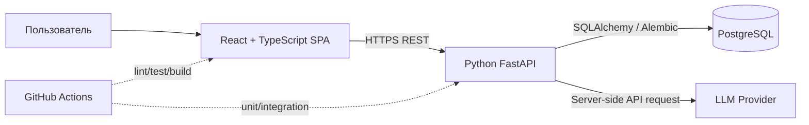
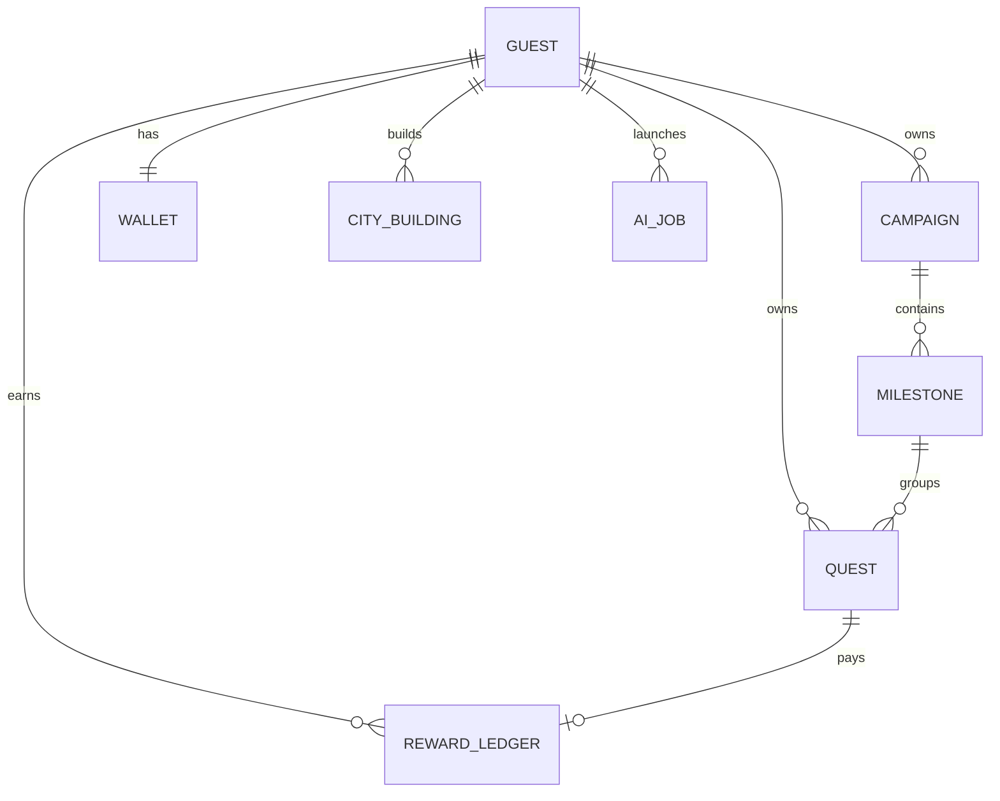

# 07. Solution architecture / Technical Design

**Решение:** лёгкий modular monolith + самостоятельный SPA frontend. Отдельные микросервисы здесь не нужны.

## System context



## Repository layout (frontend implemented; backend/Compose planned)

```text
GuildLife/
├── README.md
├── docs/                      # продуктовые/технические решения
├── planning/                  # backlog, risks, test cases
├── assets/concepts/            # design mockups, NOT implemented UI
├── frontend/                   # [IMPLEMENTED M1] Vite + React + TS
│   └── src/{components,features,data,styles,test}/
├── backend/                    # [TO BE CREATED] FastAPI
│   ├── app/{api,domain,models,schemas,services,db}/
│   ├── alembic/
│   └── tests/
├── .github/
└── compose.yaml               # [TO BE CREATED]
```

## Responsibilities

| Layer | Owns | Must NOT own |
|---|---|---|
| React | Map, navigation, inputs, optimistic UI and recoverable errors | Authoritative balance / secret API keys |
| FastAPI routing | Auth/session, validation, HTTP contracts | Direct rendering and business logic inside handlers |
| Domain/service layer | Quest completion, rewards, buildings, campaign import | LLM-generated arbitrary DB queries |
| Persistence layer | SQLAlchemy models, migrations, transactions | Product reward rules as UI text |
| AI adapter | Prompt template, provider call, JSON validation | Direct coin/XP updates |

## MVP data model



| Table | Selected columns / constraint |
|---|---|
| `guests` | uuid, created_at, expires_at; signed HttpOnly session identifier |
| `campaigns` | uuid, guest_id, title, deadline nullable, status, created_at |
| `milestones` | uuid, campaign_id, title, ordering |
| `quests` | uuid, guest_id, milestone_id nullable, title, difficulty, status, completed_at, created_at |
| `wallets` | guest_id UNIQUE, total_xp >= 0, coins >= 0 |
| `reward_ledger` | uuid, guest_id, quest_id nullable, event_type, xp_delta, coin_delta, created_at; unique `(quest_id, event_type)` for reward-once |
| `city_buildings` | guest_id, plot_id, building_type, level, built_at; UNIQUE `(guest_id, plot_id)` |
| `ai_jobs` | uuid, guest_id, status, result_json nullable, error_code, created_at, finished_at, accepted_at |

**Note:** `guest_id` must be checked on **every** resource query (IDOR protection); no anonymous global shared account with unrestricted writes. Never expose the DB directly to the browser.

## Draft REST API v1

| Method | Endpoint | Purpose |
|---|---|---|
| `GET` | `/api/v1/health` | service health |
| `POST` | `/api/v1/guest-session` | create/retrieve demo session |
| `GET` | `/api/v1/game-state` | world, wallet, buildings, selected quest summary |
| `POST` | `/api/v1/campaigns` | create campaign manually |
| `GET` | `/api/v1/campaigns` | list current campaigns |
| `GET` | `/api/v1/quests` | list/filter quests |
| `POST` | `/api/v1/quests` | create quest |
| `PATCH` | `/api/v1/quests/{quest_id}` | edit open quest |
| `POST` | `/api/v1/quests/{quest_id}/complete` | complete & reward atomically |
| `POST` | `/api/v1/buildings/build` | purchase/construct on free plot |
| `POST` | `/api/v1/ai/plan-drafts` | create planning job |
| `GET` | `/api/v1/ai/jobs/{job_id}` | poll real job status/draft |
| `POST` | `/api/v1/ai/jobs/{job_id}/accept` | validate and save confirmed plan |
| `GET` | `/api/v1/reports/weekly` | aggregate actual progress |

**Important:** the endpoints are design contracts; not yet implemented. Define OpenAPI/Pydantic schemas and align the frontend after the first implementation task.

## Money / XP transactional integrity

Quest completion: `BEGIN` → lock relevant quest/wallet row → if already done return consistent status → update quest → insert unique ledger event → update wallet → `COMMIT`. Any error means `ROLLBACK`; concurrent retries cannot double pay. Build: lock wallet/plot → check `coins >= cost` → decrement wallet → insert building → `COMMIT`. Check unique constraints for replay.

## Demo session design

- New guest receives random opaque session in **Secure + HttpOnly cookie** (SameSite rules depending on deployment). Stored hashed or securely referenced server-side; TTL for cleanup. Use CSRF protections if cookie-authenticated writes can be reached cross-site.
- Demo guest data is private to that session; no real names/email required.
- Seed data inserted for each new guest, not shared user state.
- Public AI endpoint rate-limited; global provider cost cap. Demo can start in mock AI mode if provider budget is exhausted, **clearly labeled mock**.

## Testing boundary

- **Backend unit:** reward math, quest status transitions, city purchase, AI schema validation.
- **API integration with PostgreSQL:** concurrency, idempotency, `guest_id` filtering.
- **Frontend:** component behavior and accessible states.
- **E2E:** guest → goal → plan → task completion → building → reload.
- **CI:** run format/lint/types/tests; add actual workflow only after code exists.

## Operational and deployment draft

Dev: Docker Compose for PostgreSQL/backend/frontend; frontend Vite proxy to backend. Release: static web host for frontend + managed/container backend + PostgreSQL; exact provider is open decision to avoid fake deployment guarantees. Migration on deploy, health check, rollback plan, separate staging secrets. Never commit `.env`.

## References

- FastAPI SQL / ORM: https://fastapi.tiangolo.com/tutorial/sql-databases/
- Official React + Vite/TypeScript: https://react.dev/learn/build-a-react-app-from-scratch
- Vite setup: https://vite.dev/guide/
- OWASP LLM: https://owasp.org/www-project-top-10-for-large-language-model-applications/
